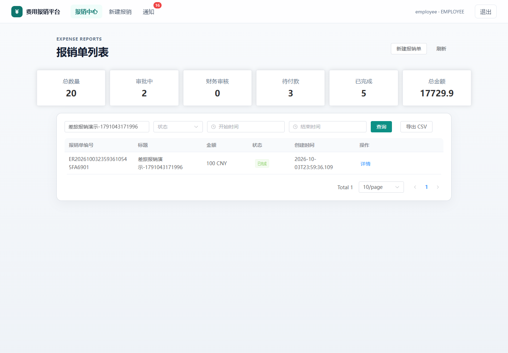
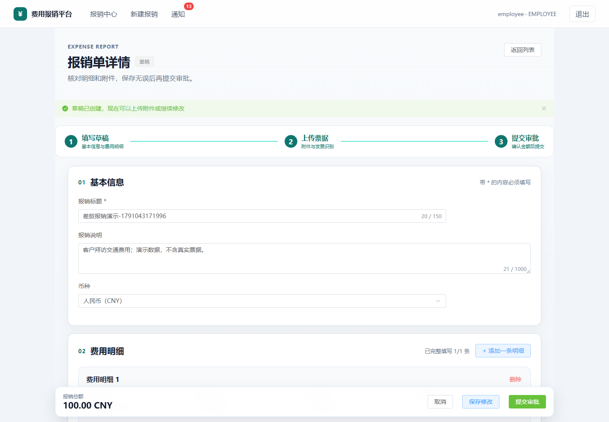
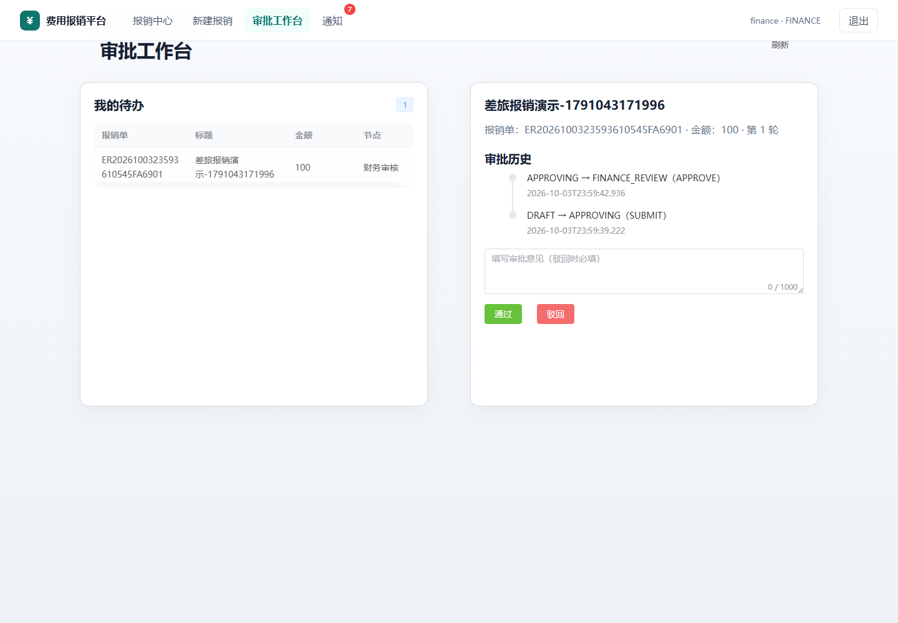
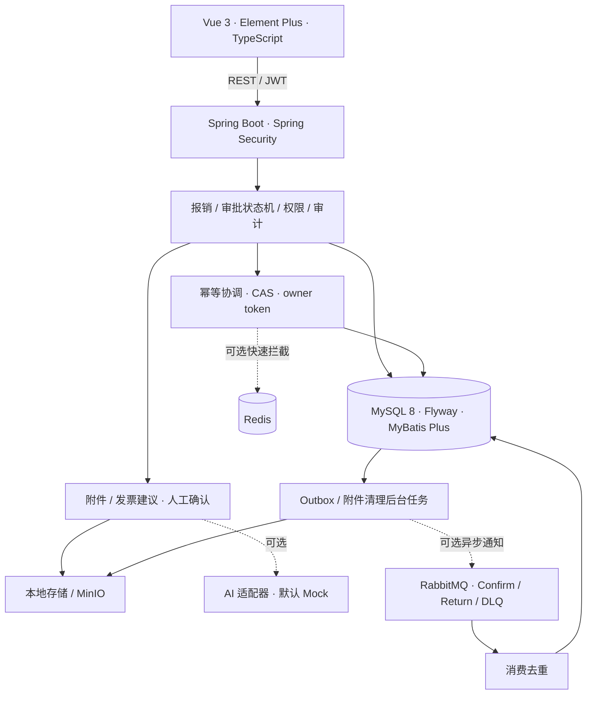

# 智能报销与费用管理平台 · Expense Platform

[](https://github.com/gaozhidao6/expense-platform/actions/workflows/ci.yml)
[](LICENSE)

基于 **Java 17 / Spring Boot 3 / MySQL 8 / Vue 3 / TypeScript** 的全栈报销项目，用于 Java 后端实习简历展示与学习。覆盖员工填报、经理审批、财务审核付款、管理员审计的完整流程。

项目关注业务状态机、服务端数据权限、提交幂等、事务失败恢复和外部依赖不可用时的处理。默认使用本地附件存储、同步站内通知和 Mock 发票识别；Redis、RabbitMQ、MinIO 与 AI 接口可按需接入。

## 演示



| 员工填报 | 经理 / 财务审批 |
| --- | --- |
|  |  |

[查看短演示视频（WebM）](docs/assets/demo.webm) · [完整演示路径](docs/DEMO_GUIDE.md) · [API](docs/API.md) · [数据字典](docs/DATA_DICTIONARY.md)

截图和视频来自本地实际运行，仅包含演示账号与模拟票据。录制步骤由 Playwright E2E 测试复现，见下方测试说明。

## 已实现与边界

| 模块 | 已实现 |
| --- | --- |
| 身份与权限 | JWT、Spring Security、多角色菜单、服务端角色与报销单归属校验 |
| 报销 | 草稿、明细、金额汇总、提交、撤回、驳回后修改、分页筛选、CSV 导出、统计 |
| 审批 | 经理 → 财务 → 付款状态机，按审批人过滤待办、审批历史、版本条件更新 |
| 幂等 | Redis 快速拦截、MySQL 唯一键、独立协调事务、CAS 接管、owner token、成功响应重放 |
| 通知 | 默认同步落库；RabbitMQ 模式使用事务 Outbox、确认发送、退避重试、消费去重与死信队列 |
| 附件 | 大小 / 类型校验、SHA-256 去重、本地 / MinIO 存储、上传回滚清理、持久化删除重试 |
| 发票建议 | Mock / AI 适配器、结构化校验、人工确认后写入正式明细 |
| 审计 | 成功与失败记录、独立失败日志、X-Request-Id 关联 |
| 工程交付 | Flyway、Swagger、自动化测试、GitHub Actions、Dockerfile、启动脚本、MIT 许可证 |

当前定位是可演示、有回归测试的学习项目。真实 AI 准确率、真实 RabbitMQ / MinIO 故障恢复和生产容量仍需独立验证；尚未提供多租户、登录限流、监控告警、备份恢复和生产级运维方案。具体规划见 [增强规划](docs/ENHANCEMENT_PLAN.md)。

## 架构



[架构与故障恢复说明](docs/RELIABILITY.md) · [幂等设计](docs/IDEMPOTENCY_DESIGN.md)

## 快速启动：Docker Compose

需要 Git 和 Docker Compose v2。此路径会构建前后端并启动 MySQL、Redis，不要求本机安装 Java、Node.js 或数据库。

```powershell
git clone https://github.com/gaozhidao6/expense-platform.git
cd expense-platform
. .\scripts\Set-JwtSecret.ps1
docker compose up --build -d
```

macOS / Linux 用 `export JWT_SECRET="$(openssl rand -base64 32)"` 代替 PowerShell 密钥脚本，再执行同样的 Compose 命令。

访问 [前端](http://localhost:5173)；首次构建需要下载依赖，先等待 [健康接口](http://localhost:8080/api/health) 返回成功。MySQL 容器映射至本机 **3307**，容器内仍使用 3306。附件与数据库通过命名卷持久化。

```powershell
docker compose logs -f backend
docker compose down
```

`down` 停止应用并保留卷；不要添加 `-v`，除非确实要清空演示数据。RabbitMQ、MinIO 是可选服务，运行 `docker compose --profile extras up -d` 可启动它们；启用应用的相应开关与容器连接参数见 [可选依赖](docs/OPTIONAL_SERVICES.md)。

## 本机启动：Windows / PowerShell

需要 **JDK 17、Maven 3.9+、Node.js 22、MySQL 8.0+**。数据库必须运行；Redis 不可用时使用 MySQL 幂等兜底。

1. 在项目根目录创建开发数据库与用户：

```powershell
Get-Content database/00_create_database.sql | mysql -u root -p
```

脚本默认创建 `expense_platform`、`expense_app / expense_app_dev`。Flyway 首次启动自动建表。已有数据库不会被重置。需要自定义连接时设置环境变量：

```powershell
$env:DB_URL='jdbc:mysql://localhost:3306/expense_platform?useUnicode=true&characterEncoding=utf8&serverTimezone=Asia/Shanghai&allowPublicKeyRetrieval=true&useSSL=false'
$env:DB_USERNAME='expense_app'
$env:DB_PASSWORD='expense_app_dev'
```

2. 启动前后端，保持终端打开；Ctrl+C 停止本次启动的进程：

```powershell
.\scripts\Start-Local.ps1
```

日志保存在忽略的 `.run/` 目录。脚本先打包后端、`npm ci`，再等待健康接口并启动 Vite。

也可用两个终端手动启动：

```powershell
# 终端 1，在根目录执行；密钥脚本前面的点号不能省略
. .\scripts\Set-JwtSecret.ps1
cd backend
mvn spring-boot:run
# 终端 2
cd frontend
npm ci
npm run dev
```

Spring Boot 不自动加载根目录 `.env`；`.env` 主要用于 Compose 变量替换，本机运行须设置环境变量。JWT_SECRET 必须独立生成，没有源码默认密钥。

## 演示账号与验收路径

| 身份 | 用户名 | 本地演示密码 | 操作 |
| --- | --- | --- | --- |
| 员工 | employee | Employee123! | 新建草稿、添加明细、上传票据、提交审批 |
| 经理 | manager | Manager123! | 审批工作台 → 选择该报销单 → 通过 |
| 财务 | finance | Finance123! | 财务审核通过 → 报销中心找到待付款报销单 → 付款并确认 |
| 管理员 | admin | Admin123! | 操作日志 → 查看提交、审批和付款记录 |

回到员工报销中心确认状态为“已完成”。登录页可直接选择身份；发票识别默认产生明确的 Mock 建议，必须人工确认。固定账号只供隔离的本地演示，对外部署前必须替换。

## 测试与 CI

```powershell
mvn -B -f backend/pom.xml verify
cd frontend
npm ci
npm test
npm run build
npx playwright install chromium
# 后端需已启动；Playwright 自动启动前端
npm run test:e2e
```

后端测试连接真实 MySQL，创建 / 清理测试自己的数据；使用独立开发数据库，切勿连接生产库。覆盖权限、状态流转、事务回滚、20 路并发接管、Redis 不可用、通知失败重试和附件清理。前端 `npm test` 是源码静态检查；Playwright 验证浏览器全流程及员工越权访问被拒绝。

本次本地验证：**136 项后端测试通过**，前端检查与生产构建通过；浏览器验证记录见 [验证说明](docs/VALIDATION.md)。GitHub CI 使用独立 MySQL，运行同样的测试、浏览器流程并构建容器镜像；未运行过 CI 前，徽章不代表已通过。

录制演示：后端启动后，在 `frontend` 中设置 `$env:RECORD_DEMO='true'`，执行 `npm run demo:record`。截图输出 `docs/assets/`，视频在 `test-results/`；将成功流程的 WebM 复制为 `docs/assets/demo.webm`。本机无法下载 Chromium 时可先执行 `npx playwright install ffmpeg`，设置 `$env:PLAYWRIGHT_CHANNEL='chrome'` 使用已安装的 Chrome。

## 常见问题

| 现象 | 排查 |
| --- | --- |
| JWT_SECRET 未解析 / 密钥不合法 | 先点号执行密钥脚本；至少 32 个随机字节的 Base64 编码 |
| MySQL Access denied / 连接失败 | 确认建库脚本、数据库运行状态与 DB_*；Compose 外部端口 3307 |
| 8080 / 5173 被占用 | 停止之前的开发实例，再启动；不要同时启动 Compose 与本机应用 |
| Redis unavailable 警告 | 本机 Redis 未启动时会降级，MySQL 仍负责幂等正确性 |
| 附件删除后文件短暂存在 | 数据库先提交删除，后台任务默认约 3 秒后清理；故障时退避重试 |
| Maven 打包无法替换 JAR | Windows 正在运行该 JAR；先停止后端再打包 |

## 目录与参与开发

`backend/` 后端 · `frontend/` 前端与 E2E · `database/` 建库脚本 · `docs/` 演示与设计 · `scripts/` 启动辅助 · `.github/` CI

[贡献说明](CONTRIBUTING.md) · [安全说明](SECURITY.md) · [更新记录](CHANGELOG.md) · [MIT License](LICENSE)
