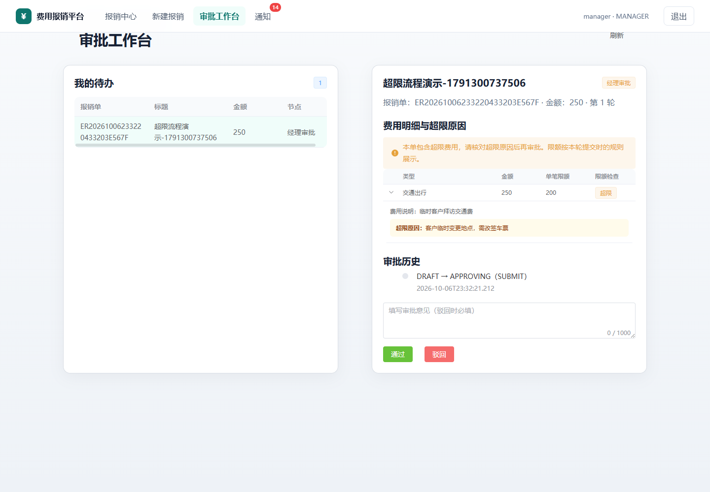

# 费用单笔限额与超限审批

本功能按费用类型配置人民币单笔限额。超限费用可以保存草稿，但提交前必须填写超限原因；经理和财务在审批工作台查看本轮限额、费用金额和申请人原因，再通过或驳回。

## 规则与范围

| 费用类型 | 初始演示限额（CNY / 单条明细） |
| --- | ---: |
| 差旅住宿 TRAVEL | 1000 |
| 餐饮招待 MEAL | 300 |
| 交通出行 TRANSPORT | 200 |
| 办公用品 OFFICE | 500 |
| 其他费用 OTHER | 500 |

金额仅用于演示，不代表公司实际报销标准。管理员登录后打开导航中的「费用规则」，修改金额或停用对应规则。金额必须大于零，最多两位小数；员工、经理和财务不能修改规则。

- 仅 `明细金额 > 限额` 算超限；金额等于限额不需要原因。
- 原因最长 500 字符，空白内容不算有效原因。草稿允许暂不填写，提交时检查每一条超限明细。
- 限额针对单条费用明细，不按人次、天数或报销单合计计算；尚不支持拆单合并检查、部门预算、币种换算或日累计限额。
- 费用类型只接受上述五种，后端拒绝自定义类型绕过校验。当前提交只支持 CNY。
- AI 发票确认可能改变明细金额；下一次提交仍根据数据库中的最终金额进行校验。
- 普通审批通过 / 驳回作为超限费用的处理决定，本版没有新增自动通过或预算扣减。

## 一次完整演示

1. 管理员在「费用规则」确认交通出行限额为 200 元并启用。
2. 员工新增交通费明细，金额 250 元。页面提示超限，可以先保存草稿。
3. 不填原因提交：页面提示，直接调用提交接口也返回 400，报销单仍为草稿，不能留下审批任务。
4. 填写「客户临时变更地点，需改签车票」，保存并提交。
5. 管理员把交通限额改为 500 元。
6. 经理进入审批工作台，仍能看到本轮限额 200 元、金额 250 元、超限标记和原因，可选择通过或驳回。
7. 如果驳回，员工编辑、重提时采用新的 500 元限额。本轮快照在新的成功提交时重新生成。

## 接口

- `GET /api/expense-policies`：已登录用户查看规则。
- `PUT /api/expense-policies/{expenseType}`：仅管理员，示例请求 `{"limitAmount":200.00,"enabled":true}`。
- 创建、添加和修改费用明细的现有接口新增可选字段 `overLimitReason`。
- 详情接口的每条明细新增 `limitAmount`、`overLimit`、`overLimitReason`。草稿 / 驳回状态展示当前规则；提交后展示本轮提交快照。
- 提交接口及 `Idempotency-Key` 用法不变。服务端读取已保存明细与当前规则，不能通过伪造 `overLimit=false` 或前端限额跳过检查。

## 一致性与历史兼容

Flyway `V9` 增加规则表、超限原因和提交限额快照。规则读取一次生成本轮校验结果，限额快照、审批任务、报销状态与幂等成功响应在同一业务事务内保存；任何后续步骤失败会一起回滚。

明细编辑、AI 确认及提交通过报销单行锁串行处理，防止校验后金额被并发修改。审批中的数据不因管理员改规则而重新解释。同一幂等请求重试复用已保存响应，不重复创建任务。

停用规则的提交保存空限额。升级前已经提交的历史明细没有限额快照，不追补历史超限判定；历史审批保持原流程。

## 验证

`ExpenseLimitIntegrationTests` 使用真实 MySQL 和 HTTP 接口覆盖金额边界、空白原因、修改原因后重试、幂等重复提交、规则快照、规则停用、提交失败回滚、配置权限、非法金额、费用类型绕过、原因长度、最新规则重查和币种限制。`expense-limits.spec.ts` 覆盖管理员配置、员工超限提示及原因填写、后端越权拒绝、审批人查看历史限额和驳回后的新规则展示。
